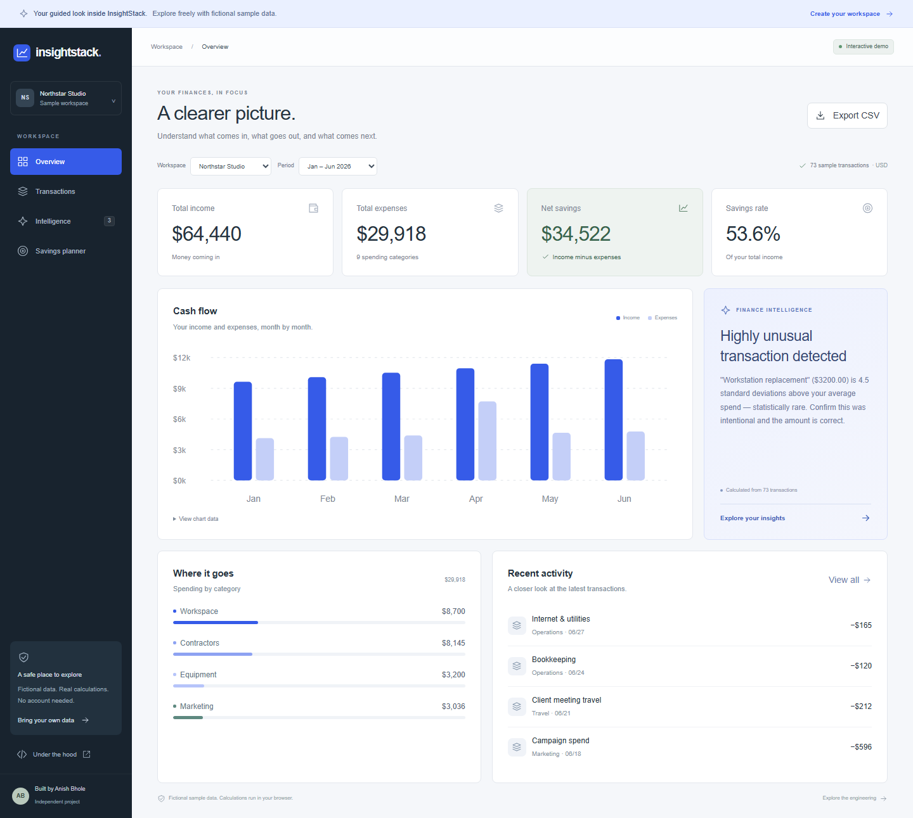
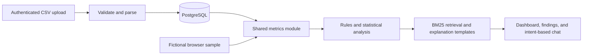

# InsightStack

**A clearer picture of your finances, from a CSV of transactions.**

InsightStack is a full-stack finance analytics project by **Anish Bhole**. It combines transaction imports, cash-flow dashboards, and an explainable analysis engine with an interactive demo that anyone can explore without an account.

[Live application](https://insightstack-peach.vercel.app) · [Interactive demo](https://insightstack-peach.vercel.app/demo) · [Engineering walkthrough](https://insightstack-peach.vercel.app/how-it-works)

> The updated experience in this branch is available locally. The public links reflect the version most recently deployed to Vercel.

## A two-minute tour

1. Open `/demo` and switch between **Northstar Studio** and **Everyday life**.
2. Change the date range and see the summary and chart recalculate.
3. Click a spending category to inspect the transactions behind it.
4. Open **Intelligence**, inspect the method, and ask a supported financial question.
5. Open **Savings planner** and explore a change in monthly expenses.
6. Export the filtered sample transactions as a CSV.

The demo contains fictional data. It uses the **same metrics and insight functions as the authenticated application**, running in the browser without database access or external AI requests.



[Landing page preview](docs/screenshots/recruiter-landing.png) · [Mobile preview](docs/screenshots/recruiter-mobile.png)

## What the project demonstrates

| Area                   | Implementation                                                                                                                                            |
| ---------------------- | --------------------------------------------------------------------------------------------------------------------------------------------------------- |
| Product experience     | Responsive landing page, interactive sample workspaces, searchable transactions, clear empty states, and a savings scenario tool                          |
| Full-stack application | Next.js App Router, TypeScript, authenticated API routes, user-owned datasets, and server-rendered account boundaries                                     |
| Data handling          | CSV parsing and validation, PostgreSQL persistence through Prisma, monthly aggregates, and versioned metric snapshots                                     |
| Analysis               | Expert rules, statistical expense outliers, linear spending trends, concentration calculations, BM25 knowledge retrieval, and template-based explanations |
| Trust boundaries       | Ownership checks, password hashing, cookie authentication, CSRF checks, rate limiting, and safe post-login return paths                                   |
| Verification           | Database-free analytics regression tests, browser tests for public flows, and PostgreSQL integration tests                                                |

## Architecture



The analysis layer is a **custom deterministic engine**, not a large language model. Its decisions are inspectable and do not require an AI API key. The tradeoff is narrower language understanding and a fixed knowledge base.

Key implementation paths:

- [`src/lib/metrics.ts`](src/lib/metrics.ts): income, expenses, monthly cash flow, expense category ranking, and outlier detection.
- [`src/lib/ai/engine.ts`](src/lib/ai/engine.ts): rule evaluation, retrieval, summaries, and derived statistics.
- [`src/lib/ai/chat.ts`](src/lib/ai/chat.ts): supported question intents and data-grounded answers.
- [`src/lib/demo.ts`](src/lib/demo.ts): deterministic fixtures and reusable demo calculations.
- [`src/components/DemoWorkspace.tsx`](src/components/DemoWorkspace.tsx): interactive workspace and accessible chart data table.
- [`src/app/api/datasets`](src/app/api/datasets): authenticated import, metrics, transactions, insights, and chat routes.
- [`prisma/schema.prisma`](prisma/schema.prisma): persistent data model.

## Run locally

Use Node.js 24 (see `.nvmrc`) and npm; the supported minimum is Node.js 22.12. A PostgreSQL instance is needed for account and upload flows; the public demo itself does not query the database.

```sh
npm ci
cp .env.example .env
# Configure DATABASE_URL, DIRECT_URL, JWT_SECRET, and NEXT_PUBLIC_APP_URL.
npm run prisma:generate
npm run prisma:deploy
npm run dev
```

On PowerShell, use `Copy-Item .env.example .env` instead of `cp` if preferred. Open [localhost:3000](http://localhost:3000).

For a **demo-only local preview**, use local placeholder database URLs and a local-only JWT secret in `.env`, generate the Prisma client, and skip `prisma:deploy`. The public routes will work, but creating accounts, logging in, and uploading data require a real database.

For a production build:

```sh
npm run build
npm start
```

### CSV contract

```csv
date,description,category,amount
2026-01-02,Salary,Income,5200.00
2026-01-05,Groceries,Food,-64.20
2026-01-08,Train pass,Transport,-110.00
```

Use ISO dates and signed amounts: negative for expenses, positive for receipts. Category spending includes only expenses; positive receipts in the same category do not cancel expenses. The importer expects these columns rather than arbitrary bank-export formats. A fixture is available at [`public/demo-transactions.csv`](public/demo-transactions.csv).

## Verification

```sh
npm run test:unit   # Analytics, sample data, CSV round-trip, safe return paths
npm run type-check
npm run lint
npm run build
```

Public browser tests need a running app and Playwright Chromium:

```sh
npx playwright install chromium
npm start -- --port 3100
# In another terminal:
npm run test:demo
```

Set `BASE_URL` to use another local server. Set `CAPTURE_SCREENSHOTS=1` to save desktop and mobile previews under the ignored `artifacts/recruiter-preview` directory. `npm run test:demo:ci` starts and stops its own production server.

```sh
npm test           # PostgreSQL-backed API integration tests
npm run test:e2e   # Authenticated user journey against a running app
node scripts/test-demo.mjs --authenticated # Start/stop a production server for that journey
```

Use a disposable test database for database-backed tests. Do not point them at a production account database. CI provisions PostgreSQL, runs migrations, builds, and executes the regression, browser, and integration suites.

## Design and engineering choices

- **Shared calculations:** the public demo is not a collection of hard-coded dashboard totals. Filters feed the same calculation and analysis modules used by the account routes.
- **Expense-only rankings:** income cannot appear as a spending category. Categories are sorted by expense size, and all categories are retained for concentration calculations.
- **Versioned snapshots:** a calculation change invalidates incompatible cached metrics without a database migration.
- **Consistent chat evidence:** anomaly answers use actual transaction evidence even after a metric snapshot has been cached.
- **Honest scenarios:** the savings planner states its assumptions and changes only the illustration, not the original dataset.
- **Progressive interaction:** charts have readable data tables, controls have labels, forms expose errors, and reduced-motion preferences are respected.

## Limits and optional services

Statistical outliers are prompts for review, not fraud determinations. Forecasts extrapolate historical data and do not establish future outcomes. The health score and savings benchmarks are heuristics. Chat handles documented financial intents rather than arbitrary conversation. The demo is temporary browser state and resets on reload.

Stripe billing, SendGrid email, and scheduled digest delivery require provider configuration. Public demo tests do not verify those services or database-backed account flows. Configure and test them separately before enabling them in production.

The authenticated browser suite covers registration, CSV upload, persisted analysis, chat, notification preferences, password changes, and logout/login. API tests cover single-use reset tokens and signed Stripe subscription events. Provider tests use local fixtures and do not charge cards or verify delivery to a real inbox. Scheduled digest requests fail closed when `CRON_SECRET` is absent.

Deployment uses the existing Vercel setup. The repository root is the Next.js application; configure environment variables, apply database migrations, and deploy the reviewed commit. Never commit `.env` files or provider credentials.

## License

MIT. See [LICENSE](LICENSE).
